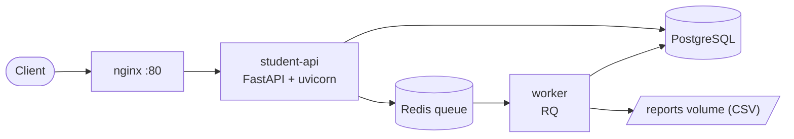
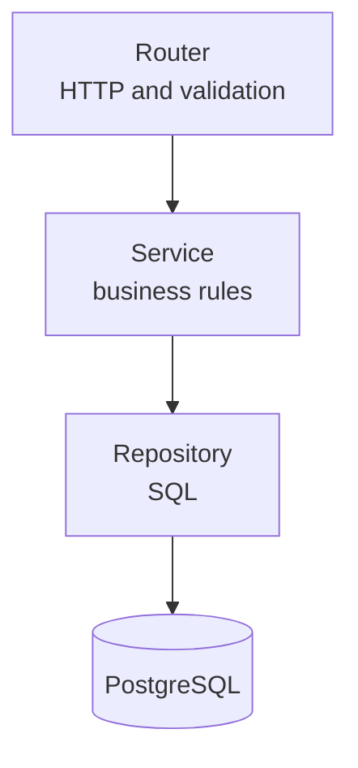
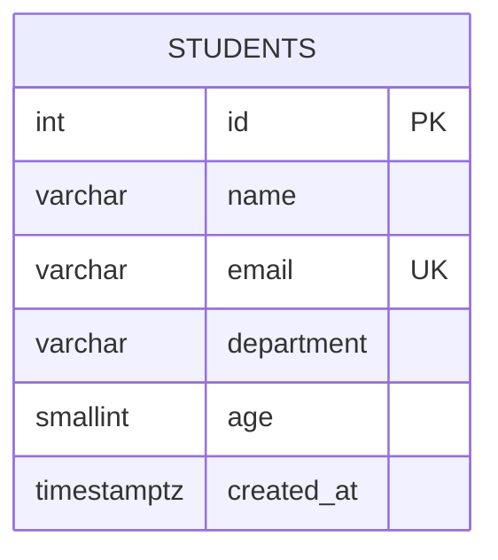

# Student Database System

A REST API for managing student records, built with FastAPI and PostgreSQL.
It adds a Redis-backed job queue with a separate worker for CSV reports,
structured logging with request tracing, health checks, and a Docker Compose
setup with an nginx reverse proxy.

## Features

- Student CRUD with validation, case-insensitive unique emails and one
  consistent JSON error format
- Pagination, search, filtering and sorting on the student list
- Asynchronous CSV reports through a Redis queue, with retries
- A request ID that follows a request through nginx, the API and the worker
- Liveness and readiness health checks (`ok`, `degraded`, `unavailable`)
- One-command startup, persistent volumes, and a tested backup and restore

## Architecture



Inside the API, code is split into layers, and each one only talks to the next:



## Quick start

Requires Docker with the Compose plugin.

```bash
git clone https://github.com/tarun-v58/Student_Database_System.git
cd Student_Database_System
cp .env.example .env          # then set DB_PASSWORD
docker compose up --build -d
docker compose ps             # wait until db, redis, student-api and nginx are healthy
curl http://127.0.0.1/health/ready
```

- API documentation (Swagger): http://127.0.0.1/docs
- Stop: `docker compose down` (data is kept). `docker compose down -v` also deletes the data.

## Configuration

Settings come from environment variables, or from `.env` (copy `.env.example`).

| Variable | Default | Meaning |
|---|---|---|
| `DB_USER`, `DB_PASSWORD`, `DB_NAME` | required | PostgreSQL credentials and database name |
| `DB_HOST`, `DB_PORT` | `localhost`, `5432` | overridden to `db` inside Compose |
| `REDIS_URL` | `redis://localhost:6379/0` | overridden to the `redis` service inside Compose |
| `REPORTS_DIR` | `reports` | where the worker writes CSV files |
| `LOG_LEVEL` | `INFO` | DEBUG, INFO, WARNING, ERROR or CRITICAL |
| `LOG_JSON` | `false` | one JSON object per log line (use in production) |
| `HTTP_PORT` | `80` | host port for nginx |

## API

| Method and path | Purpose | Success | Errors |
|---|---|---|---|
| `POST /students` | create a student | 201 | 409 duplicate email, 422 invalid |
| `GET /students` | list, with `page`, `limit`, `search`, `department`, `sort`, `order` | 200 | 422 |
| `GET /students/{id}` | one student | 200 | 404 |
| `PATCH /students/{id}` | change name, department or age | 200 | 404, 422 |
| `DELETE /students/{id}` | delete | 204 | 404 |
| `POST /reports` | start a CSV report job (optional `department`) | 202 | 503 |
| `GET /reports/{job_id}` | job status and result | 200 | 404, 503 |
| `GET /health` | liveness | 200 | |
| `GET /health/db` | database check | 200 | 503 |
| `GET /health/ready` | readiness | 200 | 503 |

Every error uses the same shape: `{"error": "student_not_found", "message": "..."}`,
and validation errors add a `details` list. Every response carries an `X-Request-ID` header.

## Running the checks

```bash
bash scripts/smoke_test.sh      # end-to-end test against the running stack
pytest -q                       # unit and integration tests
```

`pytest` needs a local PostgreSQL that matches `.env`, plus a test database:

```bash
python3 -m venv .venv && source .venv/bin/activate
pip install -r requirements.txt
sudo -u postgres psql -c "CREATE DATABASE student_test_db OWNER student_user;"
pytest -q
```

The tests rebuild their table from `docs/schema.sql` and never touch the real database.

## Project structure

```
app/
  main.py                  app assembly
  config.py                settings
  database.py              engine, sessions
  models.py  schemas.py    table model, request/response models
  exceptions.py            domain errors
  error_handlers.py        errors -> JSON
  middleware.py            request ID, access log
  logging_config.py        log format, request-ID context
  dependencies.py          wiring: session -> repository -> service
  routers/                 HTTP layer (students, reports, health)
  services/                business rules
  repositories/            the only code that writes SQL
  jobs.py  job_queue.py    report job and Redis queue
  tasks.py                 small background tasks
docs/                      schema.sql (source of truth), API design
nginx/                     reverse proxy configuration
scripts/                   smoke_test.sh, seed_demo.sh
tests/                     pytest suite
```

## Data model



Constraints live in the database as well as in the API: `name` has at least 2
characters, `age` is between 15 and 60, and emails are unique ignoring case
(an index on `lower(email)`). `lower(department)` is indexed for filtering.

## Design decisions

- **Layers:** routers know HTTP, services know the rules, repositories know SQL.
  Swapping the database touches only the repository.
- **Errors:** services raise domain errors, and one handler layer maps them to
  HTTP. Duplicates are 409 (conflict with stored data), bad input is 422.
- **Duplicates:** the service checks first for a friendly answer, and the
  database's unique index guarantees correctness when two requests race.
- **Queue and worker:** reports run in a separate process, so a slow job never
  blocks the API, and queued jobs survive restarts (Redis append-only file).
- **Readiness:** a Redis outage reports `degraded` (students still work), but a
  database outage reports `unavailable`, because the API can't do its job without it.
- **Logging:** logs go to the console, one line per request, with no personal
  data and no query strings. The request ID also reaches the worker.

## Known limitations

- No authentication or authorization: anyone who can reach the API can modify data.
- Schema changes are applied by editing `docs/schema.sql`, which only runs on a
  new database. A migration tool (Alembic) is the next step.
- HTTP only: TLS is not configured.
- Report CSV files contain student emails and are stored unencrypted.
- No metrics or distributed tracing, only logs.
- Runs on Python 3.10, which is at the end of security support.